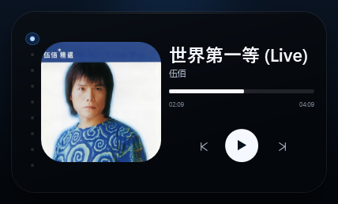
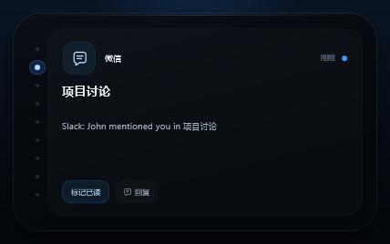
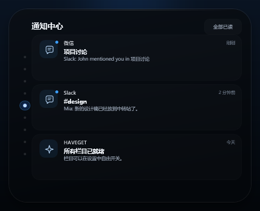
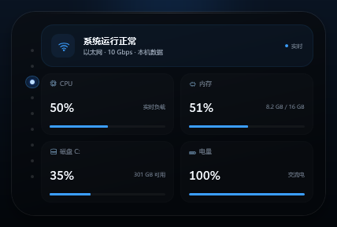
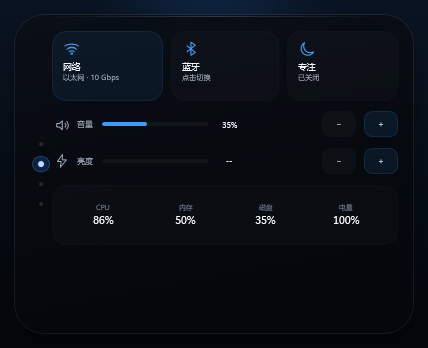
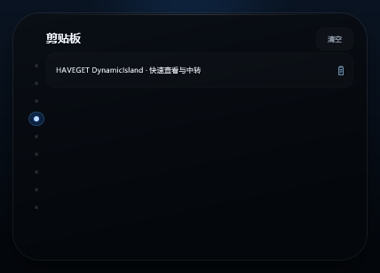
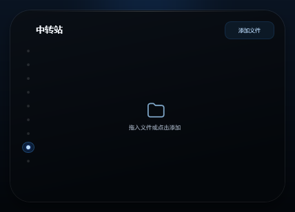
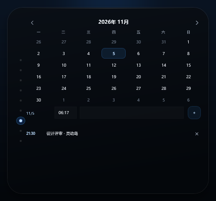
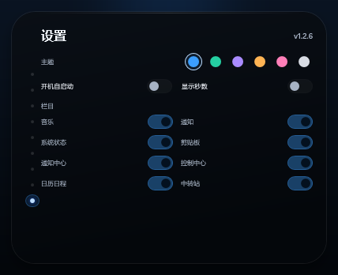

# HAVEGET DynamicIsland

> 这个还是我跟 DeepSeek 大战 300 回合后的产品。

一颗停在 Windows 顶部的黑色胶囊。初始形态只显示**时间**；点击展开当前活动，在岛内上下滚动鼠标滚轮或点击左侧圆点翻页。没有标签栏，只有当前页面的圆点会点亮。

**8 个内容栏目 + 设置页**：音乐、通知、系统状态、剪贴板、通知中心、控制中心、日历日程、中转站、设置。默认主题为**蔚蓝色**，可在设置里即时切换 6 套配色。



## 功能

- **时间胶囊**：纯黑胶囊里只保留时钟轮廓和 `HH:mm` 时间；打开「显示秒数」后变为 `HH:mm:ss`。可点击展开。
- **动态翻页**：鼠标滚轮或左侧圆点切换；设置里关掉某个栏目后，圆点会自动减少。
- **颜色主题**：蔚蓝、薄荷、紫罗兰、琥珀、玫瑰、石墨，共 6 套；默认蔚蓝，切换后即时生效并记住。
- **音乐**：读取 Windows 当前媒体会话，显示真实曲名、歌手、专辑封面、当前进度 / 总时长；播放/暂停、上一首/下一首、点击或拖动进度条都会控制当前播放器。没有媒体会话时显示“未在播放”。暂停键由两枚独立居中的直条绘制，不会偏斜。
- **通知**：微信风格通知卡片，显示应用、时间、正文，支持「标记已读」「回复」；「回复」会把一段回复草稿复制到剪贴板。
- **通知中心**：保留最近的通知记录，倒序展示，可逐条标记已读或一键全部已读。
- **系统状态**：本机 CPU、内存、磁盘、网络和电池，每 2 秒刷新。
- **剪贴板**：自动收集最近复制过的文字，点击卡片即可重新复制；最多保留 6 条，显示最近 4 条。
- **控制中心**：
  - 网络、蓝牙直接切换，不跳转 Windows 设置。
  - 系统音量、屏幕亮度（笔记本支持时）直接调节。
  - 专注模式开关；开启后不再自动弹出通知预览。
  - 底部显示 CPU、内存、磁盘和电量概览。
  - 网络/蓝牙硬件切换需要管理员权限，会弹出 UAC 确认。
- **日历日程**：月历、日期选择、日程/提醒/闹钟；提醒时间到后弹出岛内提醒并响铃。提醒保存在本机。
- **中转站**：把文件拖进岛内，或点击「添加文件」；列表中可以打开文件或移出中转站。
- **设置页**：
  - 6 套主题选择。
  - **开机自启动**开关（写入当前用户启动项，无需管理员）。
  - **显示秒数**开关：顶部胶囊时间在 `HH:mm` 和 `HH:mm:ss` 之间切换。
  - **8 个栏目开关**：音乐、通知、系统状态、剪贴板、通知中心、控制中心、日历日程、中转站。
  - 开发者模式入口：连续点击版本号 8 次，输入开发者密码。
- **开发者模式**：开发者密码 `HAVEGETTJZYY`；可调整灵动岛 X/Y 偏移、胶囊宽度、胶囊高度、胶囊时间字号，支持一键重置和关闭开发者模式。
- **干净收起**：点击面板外部、按 `Esc`，或右键点击展开面板。
- **托盘控制**：打开任意栏目、通知速览、置顶、开机启动、隐藏或退出。
- **本地优先**：系统数据、剪贴板、提醒只在本机处理；无网络请求、无遥测。

## 页面预览

| 时间胶囊 | 音乐 |
| --- | --- |
|  |  |

| 通知 | 通知中心 |
| --- | --- |
|  |  |

| 系统状态 | 控制中心 |
| --- | --- |
|  |  |

| 剪贴板 | 中转站 |
| --- | --- |
|  |  |

| 日历日程 | 设置 |
| --- | --- |
|  |  |

## 使用

1. 运行 `dist\HAVEGET-DynamicIsland-Setup.exe` 安装，或直接运行 `dist\HAVEGET DynamicIsland.exe` 便携试用。
2. 点击屏幕顶部时间胶囊展开；在展开的岛内滚轮翻页，或点击左侧圆点。
3. 点击面板外部、按 `Esc`，或右键点击展开面板收起。
4. 进入「设置」页可以切换主题、开机自启动、显示秒数和 8 个栏目开关。
5. 连续点击设置页右上角的版本号 8 次，输入开发者密码 `HAVEGETTJZYY`，即可调整 X/Y 偏移、胶囊大小和胶囊时间字号。
6. 控制中心里的网络/蓝牙切换可能弹出 UAC；音量和亮度不需要管理员。不会跳转到 Windows 设置。
7. 日历页选择日期，填写时间（`HH:mm`）和提醒内容，点击右侧 `+` 添加；时间到后岛内会弹出提醒。
8. 中转站支持把文件拖入岛内；点击文件打开，点击右侧 `×` 移出列表。

安装位置：`%LOCALAPPDATA%\Programs\HAVEGET DynamicIsland`。设置文件位于 `%LOCALAPPDATA%\HAVEGET\DynamicIsland\settings.ini`，日历提醒保存在同目录的 `reminders.txt`。

## 构建

只需要 Windows 自带的 .NET Framework 4.8 编译器，不需要额外 SDK：

```powershell
cd HAVEGET-DynamicIsland
powershell.exe -NoProfile -ExecutionPolicy Bypass -File .\build.ps1
powershell.exe -NoProfile -ExecutionPolicy Bypass -File .\build-setup.ps1
```

产物：

- `dist\HAVEGET DynamicIsland.exe`：可直接运行的便携版
- `dist\HAVEGET-DynamicIsland.exe`：主程序构建产物（安装器内嵌使用）
- `dist\HAVEGET-DynamicIsland-Setup.exe`：安装器（v1.2.6）

源码结构：

```
HAVEGET-DynamicIsland/
  src/              WPF 灵动岛源码（纯 C#，无 XAML）
  installer/        安装器、卸载器与 .NET Framework 补全
  assets/           azure 图标与品牌素材
  docs/             页面截图
  tools/            图标生成脚本
  build.ps1         编译主程序
  build-setup.ps1   编译安装包
```

## 系统要求

- Windows 10（建议 22H2）或 Windows 11；媒体同步需要 Windows 10 1809+
- .NET Framework 4.8（安装器可自动补全）
- 无需管理员权限（自动补全 .NET、控制中心的网络/蓝牙硬件切换需要 UAC）

## 说明

- 展开、翻页和收起时使用固定大小的透明窗口表面，只让岛内面板伸缩；透明区域会自动点击穿透，因此不会在切换瞬间闪出桌面。
- 通知为应用内演示数据，不读取 Windows 通知中心。
- 音乐页显示和控制的是 Windows 系统媒体会话：需要 Windows 10 1809+，并且播放器（QQ音乐、Spotify、浏览器等）支持系统媒体会话；应用本身不输出音频。
- 控制中心不会打开系统设置。网络/蓝牙属于硬件切换，会请求管理员权限；没有无线网卡或蓝牙时会显示“未检测到”。
- 亮度控制依赖 WMI，部分台式机/虚拟机不支持时会显示 `--`。
- 状态页 CPU 首次采样显示 `--`，约 2 秒后得到有效读数。

版本：v1.2.6

## 相关

- [QingHuaBan 轻画板](https://github.com/Tendo-Iya/QingHuaBan) —— C++ Win32 + GDI+ 原生白板，同一作者
- 作者主页：[Tendo-Iya](https://github.com/Tendo-Iya)
